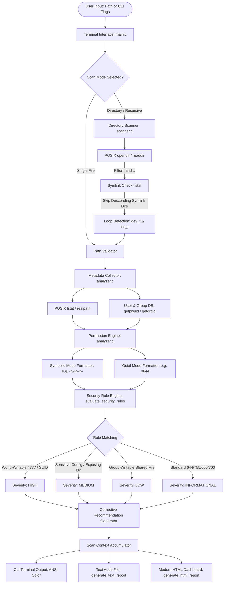

# System Architecture Document

**Project Title:** Linux File Permission Analyzer  
**Category:** Linux System Programming / Cybersecurity  
**Date:** 17 October 2026  
**Authors:**  
- **Abhishek Yadav K** (2520090208) — Metadata Collection & Representation  
- **S Venu Gopal** (2520090185) — Security Rule Engine & Severity Classifier  
- **R ROHIT** (2520080037) — Directory Scanner & Report Generation  

---

## 1. Architectural Overview

The **Linux File Permission Analyzer** is designed with a layered, decoupled pipeline architecture. It separates user interaction, filesystem traversal, POSIX metadata extraction, cybersecurity risk evaluation, and report rendering into dedicated modules.

The primary architectural goal is **safe, read-only analysis**: the tool inspects file attributes using standard POSIX kernel system calls without ever altering permissions, writing file data, or executing scanned files.

```
       +---------------------------------------------+
       |                    USER                     |
       +---------------------------------------------+
                              |
                              v
       +---------------------------------------------+
       |          Terminal Interface (main.c)        |
       |    - Interactive TUI Menu                   |
       |    - CLI Arguments Dispatcher (-f, -r, -H)  |
       +---------------------------------------------+
                              |
                              v
       +---------------------------------------------+
       |             Path Validation Layer           |
       |    - Existence & Boundary Checks            |
       |    - Root Traversing Safeguard ('/')        |
       |    - Loop & Inode Visited Tracker           |
       +---------------------------------------------+
                              |
                              v
       +---------------------------------------------+
       |     File Metadata Collector (analyzer.c)    |
       |    - POSIX lstat() & realpath()             |
       |    - getpwuid() & getgrgid()                |
       |    - Symlink Target Resolution (readlink)   |
       +---------------------------------------------+
                              |
                              v
       +---------------------------------------------+
       |             Permission Analyzer             |
       |    - Symbolic Notation Converter (-rw-r--r--)|
       |    - Octal Representation Extractor (0644)  |
       |    - SUID (4000), SGID (2000), Sticky (1000)|
       +---------------------------------------------+
                              |
                              v
       +---------------------------------------------+
       |         Security Rule Engine (RULES 01-10)  |
       |    - World-Writable File/Directory Checks   |
       |    - Sensitive File Pattern Matching        |
       |    - Sticky Bit Logic (/tmp validation)     |
       |    - Least-Privilege Baseline Evaluation    |
       +---------------------------------------------+
                              |
                              v
       +---------------------------------------------+
       |             Severity Classifier             |
       |    - HIGH / MEDIUM / LOW / INFORMATIONAL    |
       |    - Actionable chmod Guidance Generator    |
       +---------------------------------------------+
                              |
                              v
       +---------------------------------------------+
       |       Text & HTML Report Generator (report.c)|
       |    - ANSI Formatted Terminal Output         |
       |    - Plaintext Audit Reports (.txt)         |
       |    - Cyber Dark Dashboard (.html)           |
       +---------------------------------------------+
```

---

## 2. Mermaid Architecture Flowchart



---

## 3. Module Breakdown & Responsibilities

### Module 1: Terminal Interface (`src/main.c`)
- **Role:** Handles application bootstrapping, command-line argument parsing (`getopt` style flags `-f`, `-d`, `-r`, `-H`, `-t`), and presents the interactive 8-option terminal menu.
- **Safety Mechanism:** Prompts confirmation before allowing recursive scanning of the root directory (`/`) to avoid accidental system overhead.
- **Session State:** Maintains an active `ScanContext` in memory across menu selections, allowing immediate subsequent report exports or findings review.

### Module 2: Metadata Collector & Permission Analyzer (`src/analyzer.c`, `src/analyzer.h`)
- **Role:** Directly interfaces with the Linux kernel via POSIX system calls.
- **Key System Calls:**
  - `lstat()`: Retrieves file attributes without dereferencing symbolic links, allowing the tool to audit the link itself and prevent circular symlink attacks.
  - `realpath()`: Resolves absolute canonical paths.
  - `readlink()`: Safely identifies target destinations of symbolic links.
  - `getpwuid()` and `getgrgid()`: Translates numeric UIDs and GIDs into human-readable user and group names.
  - `localtime_r()`: Re-entrant thread-safe conversion of file timestamps.
- **Data Translation:**
  - Converts raw `mode_t` bitmasks into 10-character symbolic representations (`-rwxr-xr-x`, `drwx------`).
  - Converts bitmasks into 3-digit and 4-digit octal representations (`0644`, `0755`, `1777`, `4755`).

### Module 3: Security Rule Engine & Severity Classifier (`src/analyzer.c`)
- **Role:** Evaluates extracted permissions against 10 documented cybersecurity rules:
  1. `RULE-00` (INFO): Symbolic link identification.
  2. `RULE-01` (HIGH): World-writable regular file (`S_IWOTH`).
  3. `RULE-02` (HIGH): Full `777` unrestricted file permissions.
  4. `RULE-03` (HIGH): World-writable directory lacking the sticky bit (`!S_ISVTX`).
  5. `RULE-04` (HIGH/MEDIUM): Sensitive credential/configuration exposure (`.env`, `id_rsa`, `.pem`, `.key`).
  6. `RULE-05A/B` (HIGH/MEDIUM): Setuid (`S_ISUID`) and Setgid (`S_ISGID`) privilege escalation flags.
  7. `RULE-06` (INFO): World-writable directory with valid sticky bit (e.g. `/tmp`, `1777`).
  8. `RULE-07` (LOW): Group-writable regular file.
  9. `RULE-08` (HIGH): Executable file with world-write permissions.
  10. `RULE-09` (MEDIUM/HIGH): Exposed sensitive directory (`.ssh`, `.gnupg`).
  11. `RULE-10` (INFO): Standard least-privilege compliant baseline (`644`, `755`, `600`, `700`).

### Module 4: Recursive Directory Scanner (`src/scanner.c`, `src/scanner.h`)
- **Role:** Traverses single directories or deep nested trees.
- **Safeguards:**
  - **Loop Detection:** Dynamically tracks visited `(dev_t, ino_t)` device and inode pairs to avoid infinite filesystem loop traps.
  - **Symlink Boundary:** Never follows symbolic links into child directory trees.
  - **Depth Boundary:** Enforces a configurable `max_depth` (default 25 levels).
  - **Error Resilience:** Catches `EACCES` / `EPERM` without terminating, logging an informational or medium finding for permission-denied entries.

### Module 5: Report Generation Engine (`src/report.c`, `src/report.h`)
- **Role:** Serializes scan results into presentation-ready artifacts:
  - **Text Reports:** Monospaced ASCII summary tables suitable for sysadmin audit logs.
  - **HTML Reports:** Modern cybersecurity dashboards styled with dark navy backgrounds, status pill badges, interactive JavaScript filters, search inputs, and one-click copyable `chmod` remediations.
  - **Security:** Rigorous `escape_html()` sanitation prevents Cross-Site Scripting (XSS) from malicious filenames.

---

## 4. Key Data Structures

```c
typedef struct {
    char path[4096];
    char filename[256];
    struct stat stat_buf;
    mode_t mode;
    char symbolic_perm[12];
    int octal_perm;
    uid_t uid;
    gid_t gid;
    char owner_name[64];
    char group_name[64];
    off_t size;
    char human_size[32];
    time_t mtime;
    char mtime_str[64];
    FileType file_type;
    bool is_symlink;
    char symlink_target[4096];
} PermissionInfo;

typedef struct {
    char path[4096];
    char filename[256];
    int octal_perm;
    char symbolic_perm[12];
    SeverityLevel severity;
    char rule_id[16];
    char title[128];
    char explanation[512];
    char recommendation[512];
    char suggested_chmod[4160];
} SecurityFinding;
```

---

## 5. Security & Isolation Guarantees

1. **Zero State Mutation:** The application never executes `chmod`, `chown`, `unlink`, or file writes against analyzed targets.
2. **Safe Recommendations:** Generated `chmod` commands are printed as non-destructive recommendations for the administrator's review.
3. **Buffer Safety:** All string operations utilize bounded safe copy routines (`safe_copy`) and bounded format specifiers, eliminating buffer overflows and compiler truncation warnings.
